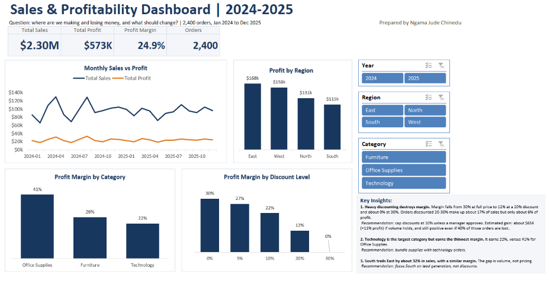

# Sales & Profitability Dashboard (Excel)

**Business question:** Where are we making and losing money, and what should change?

## Overview
An interactive Excel dashboard built on a **simulated retail dataset** (2,436 raw rows, 2,400 orders after cleaning, Jan 2024 to Dec 2025). The data was generated for portfolio demonstration, so the focus is the analysis workflow rather than real company figures.

**Tools:** Excel (PivotTables, PivotCharts, slicers, calculated fields, formulas)

## Data cleaning
All fixes are documented in the `Cleaning_Log` sheet.
- Removed 36 duplicate rows
- Standardised 60 inconsistent region labels and trimmed extra spaces in the segment column
- Filled 40 missing segments with "Unknown" instead of deleting real sales
- Corrected 12 negative quantities (sales and profit were positive, so a sign error)
- Verified totals after cleaning: sales $2,300,459, profit $572,507, margin 24.9%

## Key findings
1. **Heavy discounting destroys margin.** Margin falls from 30% at full price to 12% at a 20% discount and about 0% at 30%. Orders discounted 20-30% make up about 17% of sales but only about 6% of profit.
2. **Technology is the largest category but earns the thinnest margin.** It earns 22%, versus 41% for Office Supplies.
3. **South trails East by about 32% in sales, with a similar margin.** The gap is volume, not pricing.

## Recommendations
- Cap discounts at 10% unless a manager approves. Estimated gain: about $65K (+11% profit) if volume holds, and still positive even if 40% of those orders are lost.
- Bundle Office Supplies with Technology orders.
- Focus South on lead generation, not discounts.

## Files
| File | Description |
|---|---|
| `Sales_Analysis.xlsx` | Final workbook: Clean_Data, Cleaning_Log, pivot tables, Dashboard |
| `1_excel_sales_raw.xlsx` | Original simulated raw data, untouched |
| `excel-dashboard.png` | Dashboard screenshot |

## How to use
Download `Sales_Analysis.xlsx`, open the **Dashboard** sheet, and use the Year, Region, and Category slicers to filter every chart and KPI.

## Author
Ngama Jude Chinedu | [LinkedIn](https://www.linkedin.com/in/njc-data) | [GitHub](https://github.com/Njc-DATA)
